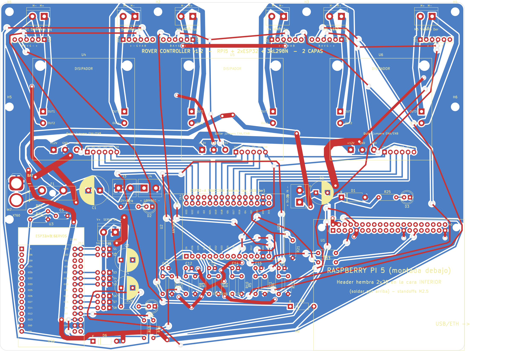

# Rover Controller v1.2: PCB de 2 capas (KiCad)

PCB de **2 capas** (F.Cu arriba y B.Cu abajo) de 200 × 150 mm. Los módulos se montan encima y la tarjeta los interconecta, así que los únicos cables que salen son los de **batería, motores/encoders, servos y reguladores**.

| Bloque | Módulo | Función |
|---|---|---|
| U1 | **Raspberry Pi 5**, debajo de la PCB con header hembra 2x20 | Cerebro |
| U2 | **ESP32 DevKit V1 30p** (ESP32-A, horizontal) | Tracción: 6 motores + 6 encoders |
| U3 | **ESP32 DevKit V1 30p** (ESP32-B, vertical) | 4 servos de dirección + 3 del brazo + 1 de reserva, voltaje de batería |
| U4–U6 | **3× L298N (HW-095)** con pines en vez de bornas | 6× Pololu 37D 12V 30:1 |
| J1 | **XT60 macho** | Batería LiPo 3S (Gens Ace 5000 mAh) |
| J3 / J4 / J5 / J6 | Borneras 5.08 mm | 12 V hacia el step-down de 5 V, 12 V hacia el BEC de servos, entrada de 5 V/5 A y entrada de servos a 6 V |
| J11–J16 + J21–J26 | Bornera + header 1x6 (cable Pololu) | Motores y encoders |
| J31–J38 | Header 1x3 (GND, V+, SIG) | Servos |



**Estado:** ruteada al 100 %. DRC de KiCad: **0 violaciones y 0 conexiones pendientes**. Además `tools/check_proto.py` confirma **0 conexiones abiertas sin barrenos metalizados**. Lleva 101 vías de 2.2/1.0 mm.

**Un solo diseño sirve para dos formas de fabricar.** La PCB se diseñó para funcionar sin metalizado; con metalizado (PTH) funciona igual.

| Fabricación | Paquete | Para quién |
|---|---|---|
| **Prototipado CNC** (sin PTH, sin máscara) | `fab/rover_controller_v1.2_prototipado.zip` | Servicio de prototipado de AG Electrónica (1 h a 1 día) |
| **Industrial + ensamble THT** | `fab/rover_controller_v1.2_PCBWay.zip` (detalle en `fab/pcbway/`) | PCBWay, llave en mano: todo soldado menos L298N y Pi |

## Cambios en la v1.2

| Cambio | Por qué |
|---|---|
| **Modo prototipado:** cada pad conecta solo por la cara donde se suelda (abajo; el header de la Pi, arriba). Las pistas de arriba van solo de vía a vía. Las vías son de 2.2/1.0 mm para meter un pin y soldarlo por ambas caras. | El servicio de prototipado no metaliza barrenos. |
| **L298N de 43.9 × 43.9 mm** con barrenos de **Ø4.0 mm a ±18.75 mm**, solo los 2 del lado del disipador | Las fuentes dan separaciones de 36.6, 37, 37.2 y 38.0 mm; un barreno de 4 mm acepta un M3 en cualquier separación entre 36.5 y 38.5 mm. El lado de los pines queda fijo por los 13 pines soldados. |
| GND de los pines 25 y 39 de la Pi con vía propia | Libera la salida del pin 29 (UART2 RX). |
| Pista de 12 V entre U4 y U6 desplazada | Deja lugar a la vía de GND de U5. |

## Cambios en la v1.1 (revisión de diseño)

| Cambio | Por qué |
|---|---|
| Retorno de **GND de potencia de 3 mm**, igual que VBAT | Con 6 motores el retorno puede pasar de 10 A. |
| **1 nF del nodo de cada encoder a GND** (C11–C16) | Junto con los 10k forma un filtro RC de ~7 µs contra el ruido del PWM de los motores. |
| **Schottky 1N5819 en el VIN de cada ESP32** (D5, D6) | Al conectar el USB a la PC, no se retroalimenta el +5 V de la Pi ni el puerto USB. |

| Corriente máx. aprox. (IPC-2221, +20 °C, cobre externo) | 1 oz | 2 oz |
|---|---|---|
| 3.0 mm: VBAT y GND de potencia | 7.2 A | 11.9 A |
| 2.0 mm: motores y +5V | 5.4 A | 8.9 A |

**Tierra común:** existe una sola red `GND` que une batería, L298N, Pi, ESP32, servos y encoders, con plano de GND relleno en la cara inferior.

## Fabricación A: prototipado CNC (sin metalizado)

Sube `fab/rover_controller_v1.2_prototipado.zip`: cobre superior, cobre inferior, contorno y **un solo archivo de taladros**. También incluye `vias_pines.csv` con la posición de cada vía-pin.

1. Pide **2 caras, sin máscara ni serigrafía**. Si es posible, usa placa con cobre de 2 oz (o estaña las pistas de potencia).
2. **Vías-pin (101):** mete un pin de header (o un alambre de 0.8–0.9 mm) en cada vía y **suéldalo arriba y abajo**. Hazlo **antes** de montar los L298N y las ESP32, porque algunas quedan debajo. Corta los pines a ras.
3. **Componentes:** todos van arriba y se sueldan **por abajo**. La única excepción es el **header 2x20 de la Pi**: va abajo y se suelda **por arriba**.
4. Revisa continuidad de 12 V, 5 V, 6 V y GND contra GND (no debe haber corto) antes de conectar módulos.
5. Para guiarte al soldar: `docs/cobre_superior_FCu_1a1.pdf`, `docs/cobre_inferior_BCu_espejo_1a1.pdf` y `docs/plantilla_1a1.pdf`.

## Fabricación B: PCBWay (PCB + ensamble llave en mano)

Todo en `fab/pcbway/`. La hoja **`cotizacion_PCBWay_rover_v1.2.png`** trae los valores exactos de los formularios.

| Archivo | Uso |
|---|---|
| `rover_controller_v1.2_gerbers_PCBWay.zip` | Gerbers con máscara y serigrafía + taladros PTH/NPTH |
| `rover_controller_BOM_PCBWay.xlsx` / `.csv` | 24 números de parte, 70 piezas. U4–U6 marcados DNP. |
| `rover_controller_centroides.csv` | Posición y rotación de cada componente |
| `plano_montaje_superior.pdf`, `plano_montaje_inferior_espejo.pdf` | Planos de montaje |

- **PCB:** 2 capas, FR-4 1.6 mm, **cobre de 2 oz**, HASL sin plomo, máscara verde.
- **Ensamble:** turnkey THT por las dos caras: todo arriba, más el header 2x20 de la Pi abajo.
- **No se sueldan:** los L298N (los instalas tú), la Raspberry Pi 5 y las ESP32. De las ESP32 solo se sueldan sus zócalos 1x15.
- Si cambias componentes, vuelve a generar el BOM con `python3 tools/bom_pcbway.py`.

**Barrenos de montaje al chasis:** 8 M3 en las orillas (H1–H8), más los 4 M2.5 de la Raspberry Pi.

## Estructura

```
hardware/
├── rover_controller/          Proyecto KiCad (abrir rover_controller.kicad_pro)
│   ├── rover.kicad_sym / rover.pretty/   símbolos y footprints propios
│   └── bom.csv                lista de materiales
├── tools/
│   ├── rover_design.py        FUENTE DE VERDAD: pines, redes, posiciones, cotas, guías de ruteo
│   ├── generate.py            genera el esquemático y la PCB (--route: rutea)
│   ├── router1l.py            ruteador (2 capas; LAYERS = 1 en rover_design.py para una capa con puentes)
│   ├── fix_proto.py           cierre puntual de pendientes (quitar/agregar pistas y re-rutear redes)
│   ├── cierre_v1.2.sh         registro de los cierres hechos en la v1.2
│   ├── check_proto.py         verifica conectividad SIN barrenos metalizados
│   ├── bom_pcbway.py          BOM para ensamble llave en mano
│   └── export_fab.sh          paquetes de prototipado y PCBWay, PDFs 1:1 e imágenes
└── docs/
firmware/common/rover_pins.h   mapa de pines para el firmware
```

Para regenerar, usa el Python de KiCad 7 o posterior con `numpy` y `scipy` instalados. El ruteo es determinista y tarda unos 25 minutos. En la v1.2 dejó 6 pads pendientes, que se cerraron con `tools/fix_proto.py` (los comandos están en `tools/cierre_v1.2.sh`). Sin `--route` el script no sobrescribe una PCB ya ruteada.

```bash
python3 hardware/tools/generate.py --route
```

```bash
hardware/tools/export_fab.sh
```

## Antes de fabricar: verifica las cotas

**L298N:** el footprint usa el plano de tu módulo (43.9 × 43.9 mm, barrenos a 38.0 mm). Las fuentes no coinciden (36.6 / 37 / 37.2 / 38 mm) y ninguna da la posición de los pines. **Imprime `docs/plantilla_1a1.pdf` al 100 %** y pon encima un L298N sin bornas, las ESP32 y la Pi. Si un pin no coincide, corrige el diccionario `L298N`, `ESP32` o `RPI` en `rover_design.py` y vuelve a generar.

La fila doble de pads de cada ESP32 acepta clones con 25.4 o 22.86 mm entre filas.

## Montaje

### L298N

1. Desuelda las 3 bornas azules y el header 1x6 (`ENA IN1 IN2 IN3 IN4 ENB`).
2. **Quita los jumpers ENA/ENB.** En la PCB van a `MOTOR_EN`.
3. **Deja puesto el jumper 5V-EN.** El regulador 78M05 del módulo alimenta su lógica, y su pin **+5V alimenta los dos encoders** de ese módulo.
4. Suelda header macho por arriba del módulo, con los pines saliendo por abajo, en las 7 posiciones de potencia y las 6 lógicas.
5. Atornilla el lado del disipador con 2 standoffs M3 (barrenos de 4 mm en la PCB) y suelda los 13 pines por abajo.

### Raspberry Pi 5

1. Suelda un **header hembra 2x20** en la **cara inferior**; los pines se sueldan por arriba.
2. Si quieres acceder por arriba a los GPIO libres, usa en su lugar un **stacking header** de pines largos: los pines sobresalen sobre la PCB y ahí conectas cables Dupont.
3. Monta la Pi debajo con standoffs M2.5: 11 mm, o 16–18 mm con el Active Cooler.

### ESP32

Van sobre headers hembra 1x15, así que se pueden quitar.

- **ESP32-A** va horizontal, con la antena a la izquierda y el USB a la derecha.
- **ESP32-B** va vertical, con la antena arriba y el USB abajo.

## Arquitectura eléctrica

```
Batería 3S (XT60) ─► F1 15 A ─► VBAT_F ─┬─► L298N +12V (x3)
                                         ├─► J3 ─► step-down 5V/5A ─► J5 ─► +5V (Pi 5, ESP32)
                                         └─► J4 ─► BEC 6V ≥10A ─────► J6 ─► SERVO_V (8 servos)
L298N (regulador 78M05 del módulo) ─► +5V de los encoders de sus 2 motores
```

- **Pi 5 por GPIO:** en `/boot/firmware/config.txt` agrega `usb_max_current_enable=1`. Además corre `sudo rpi-eeprom-config -e` y pon `PSU_MAX_CURRENT=5000`. Para proteger la Pi hay un TVS SA5.0A (D1) y 1000 µF (C2).
- **UART sin cables:** la Pi tiene UART2 (GPIO4/5, `/dev/ttyAMA2`) hacia la ESP32-A y UART0 (GPIO14/15, `/dev/ttyAMA0`) hacia la ESP32-B, con 1k en serie. Activa `dtoverlay=uart2-pi5` y `dtoverlay=uart0-pi5`.
- **Asignación de pines** (ver `firmware/common/rover_pins.h`): está pensada para que el ruteo quede limpio.
  - En la ESP32-A, los IN1–IN4 de los tres L298N siguen el mismo orden que la fila de pines, así que las pistas bajan en abanico sin cruzarse.
  - En la ESP32-B, cada servo queda a la misma altura que su GPIO.
- **`MOTOR_EN`** (IO13 de la ESP32-A, con pull-down) habilita los 6 canales. Los motores no se mueven mientras arranca la ESP32.
- **Encoders:** solo el canal A, con divisor 10k/20k de 5 V a 3.3 V.
- **Batería:** IO34 de la ESP32-B, con divisor 100k/27k. Corta los motores si la LiPo baja de 3.3 V por celda (9.9 V).

### Componentes discretos

- Resistencias de **1/4 W** de orificio pasante.
- **LEDs de 5 mm:** D2 rojo (12 V), D3 verde (5 V) y D4 azul (servos).
- Electrolíticos radiales, TVS en encapsulado DO-15 y portafusible ATO.

## ⚠️ Limitaciones

1. **L298N vs. Pololu 37D:** el motor pide hasta **5.5 A** cuando se bloquea y el L298N soporta unos 2 A continuos por canal. Además pierde 2–3 V. Usa rampas de PWM y detecta bloqueos con el encoder.
2. **ESP32-A:** GPIO1 (TX0) maneja un IN del L298N. No uses `Serial.print()` mientras controlas los motores; para telemetría usa `Serial2` hacia la Pi.
3. No hay protección contra polaridad inversa. Respeta la polaridad del XT60: lado recto = +, lado biselado = −.
