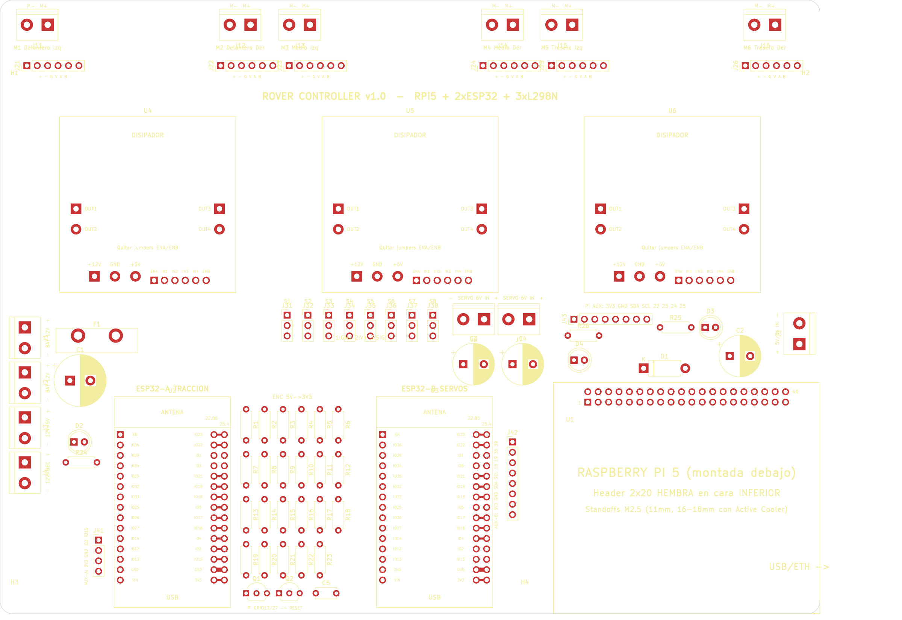

# Rover Controller v1.0: PCB portadora en KiCad

PCB de 2 capas (200 × 150 mm) que conecta, sin cables entre módulos:

| Bloque | Módulo | Función |
|---|---|---|
| U1 | **Raspberry Pi 5** (montada debajo, estilo HAT) | Cerebro principal |
| U2 | **ESP32 DevKit V1 30p** (ESP32-A) | Tracción: 6 motores + 6 encoders |
| U3 | **ESP32 DevKit V1 30p** (ESP32-B) | 4 servos de dirección + 3 del brazo + 1 de reserva, voltaje de batería |
| U4–U6 | **3× L298N (HW-095)** con pines en vez de bornas | 6× Pololu 37D 12V 30:1 |
| J1–J7, J11–J16 | Borneras 5.08 mm | Batería, salidas de 12 V, entradas de 5 V y 6 V, motores |



## Estado

| Paso | Estado |
|---|---|
| Esquemático (`rover_controller.kicad_sch`) | ✅ Generado. El netlist coincide 1:1 con la PCB (85 redes) |
| Footprints propios (L298N, ESP32 de doble paso, RPi5) | ✅ |
| Colocación de componentes, clases de red, planos de GND, keepout de antenas | ✅ DRC: 0 violaciones |
| **Ruteo de pistas** | ⏳ **Pendiente** (ver [Ruteo](#ruteo)) |
| Gerbers | Se generan con `tools/export_fab.sh` **después** de rutear |

## Estructura

```
hardware/
├── rover_controller/        Proyecto KiCad (abrir rover_controller.kicad_pro)
│   ├── rover.kicad_sym      Símbolos propios
│   ├── rover.pretty/        Footprints propios
│   └── bom.csv              Lista de materiales
├── tools/
│   ├── rover_design.py      FUENTE DE VERDAD: pines, redes, posiciones, cotas
│   ├── generate.py          Genera sch + pcb (+ --route con Freerouting)
│   └── export_fab.sh        Gerbers, taladros, PDF e imágenes
└── docs/
    ├── rover_controller_schematic.pdf
    ├── plantilla_1a1.pdf    Imprimir al 100 % para verificar los módulos
    └── img/
firmware/common/rover_pins.h Mapa de pines para el firmware de las ESP32
```

Si cambias algo (una cota, un pin o una posición), edita `tools/rover_design.py` y vuelve a generar:

```bash
python3 hardware/tools/generate.py
```

Necesitas el Python que trae KiCad 7 o posterior, porque usa el módulo `pcbnew`. **Ojo:** el generador sobrescribe la `.kicad_pcb`. Cuando empieces a rutear a mano, deja de regenerarla.

## Antes de fabricar: verifica las cotas

Las posiciones de los pines del **L298N** se tomaron de las medidas típicas del HW-095 (43 × 43 mm, agujeros M3 a 36.6 mm). Los clones varían, así que antes de pedir la PCB:

1. Imprime `docs/plantilla_1a1.pdf` al **100 %** (sin "ajustar a página").
2. Coloca encima cada L298N (ya sin bornas), las ESP32 y la Pi. Los agujeros deben coincidir.
3. Si algo no cuadra, mide con calibrador y corrige el diccionario `L298N` (o `ESP32` o `RPI`) en `rover_design.py`.

Los pads de potencia del L298N tienen taladro de 1.3 mm, con ±0.3 mm de holgura para pines de 0.64 mm.

**ESP32:** la fila derecha tiene **dos juegos de pads**, a 25.4 mm y a 22.86 mm de la fila izquierda, porque los clones de 30 pines vienen en ambos anchos. Suelda el header hembra en la fila que coincida con tu placa. Confirma también que el orden de pines de la serigrafía de tu placa coincida con el de la PCB (EN arriba a la izquierda, 3V3 abajo a la derecha, antena arriba).

## Cómo adaptar los L298N

1. Desuelda las 3 bornas azules (OUT1/2, OUT3/4 y la de 3 vías +12V/GND/+5V) y el header 1x6 `ENA IN1 IN2 IN3 IN4 ENB`.
2. **Quita los jumpers ENA y ENB.** En esta PCB, ENA y ENB van a `MOTOR_EN`.
3. **Deja puesto el jumper 5V-EN.** Con batería de 12 V, el regulador del módulo alimenta su propia lógica. El pin +5V del módulo **no se conecta** en la PCB; solo da soporte mecánico.
4. Suelda header macho por la cara de arriba del módulo, con los pines saliendo por abajo, en las 7 posiciones de potencia y las 6 lógicas.
5. Monta el módulo con standoffs M3 en sus 4 agujeros (la PCB tiene los agujeros). Puedes soldar los pines directo a la PCB, o usar sockets hembra para poder cambiar el módulo.

## Arquitectura eléctrica

### Alimentación

```
Batería 12V (3S) ─► J1/J2 (en paralelo) ─► F1 (ATO 15 A) ─► VBAT_F ─┬─► L298N +12V (x3)
                                                                    ├─► J3 ─► step-down 5V/5A ─► J5 ─► +5V (Pi 5, ESP32 VIN, encoders)
                                                                    └─► J4 ─► BEC 6V ≥10A ─► J6/J7 ─► SERVO_V (8 servos)
```

- La **Pi 5 se alimenta por los pines 5V del GPIO** (pines 2 y 4). Usa un step-down de **5.1 V / 5 A** (por ejemplo XL4015 ajustado, o un UBEC 5V 5A). Este camino no pasa por la protección del USB-C de la Pi, así que la PCB lleva un TVS SA5.0A (D1) y 1000 µF (C2). En la Pi:
  - En `/boot/firmware/config.txt`: `usb_max_current_enable=1`
  - Con `sudo rpi-eeprom-config -e`: `PSU_MAX_CURRENT=5000`
- **Servos Power HD 1501MG:** el rail `SERVO_V` está separado del de 5 V. Los servos funcionan de 4.8 a 6 V y piden varios amperes cuando se bloquean, así que con 7 servos usa un BEC de **6 V y ≥10 A**. C3 y C4 (2× 1000 µF) absorben los picos.
- LEDs indicadores: D2 (12 V), D3 (5 V) y D4 (servos).
- Clases de red: `BATT` 3.0 mm, `MOTOR` 2.0 mm, `PWR` (+5V, SERVO_V) 2.0 mm, `GND` 1.0 mm más planos en ambas caras. **Pide cobre de 2 oz.**

### Raspberry Pi 5 ↔ ESP32

| Pi 5 (BCM) | Pin físico | Destino |
|---|---|---|
| GPIO14 TXD0 / GPIO15 RXD0 | 8 / 10 | ESP32-A RX2(16) / TX2(17), con 1k en serie. En la Pi: `dtoverlay=uart0-pi5` → `/dev/ttyAMA0` |
| GPIO4 TXD2 / GPIO5 RXD2 | 7 / 29 | ESP32-B RX2(16) / TX2(17), con 1k en serie. En la Pi: `dtoverlay=uart2-pi5` → `/dev/ttyAMA2` |
| GPIO17 | 11 | HIGH → resetea la ESP32-A (Q1 2N3904 lleva EN a GND) |
| GPIO27 | 13 | HIGH → resetea la ESP32-B (Q2) |
| GPIO2/3 (I2C1), GPIO22–25 | 3, 5, 15, 16, 18, 22 | Header J43 para IMU o sensores |

Para actualizar el firmware de las ESP32 sin cable (el DevKit de 30 pines no expone GPIO0), usa OTA por WiFi o una actualización OTA por UART desde la Pi.

### ESP32-A: tracción

| Motor | L298N | IN_A | IN_B | Encoder A |
|---|---|---|---|---|
| M1 Delantero Izq | U4 OUT1/2 | IO32 | IO33 | IO36 (VP) |
| M2 Delantero Der | U4 OUT3/4 | IO25 | IO26 | IO39 (VN) |
| M3 Medio Izq | U5 OUT1/2 | IO27 | IO13 | IO34 |
| M4 Medio Der | U5 OUT3/4 | IO23 | IO22 | IO35 |
| M5 Trasero Izq | U6 OUT1/2 | IO21 | IO19 | IO14 |
| M6 Trasero Der | U6 OUT3/4 | IO18 | IO5 | IO4 |

- **`MOTOR_EN` = IO12** va a los 6 ENA/ENB y tiene un pull-down de 10k. Los motores quedan apagados mientras la ESP32 arranca, aunque los pines parpadeen. Esto también garantiza que IO12 (pin de strapping) esté en LOW al arrancar.
- Para controlar la velocidad, el PWM va en un IN y el otro queda en LOW (decaimiento lento). Son 12 canales LEDC.
- **Encoders:** el header 1x6 de cada motor coincide con el cable Pololu (rojo M+, negro M−, verde GND, azul VCC = 5 V, amarillo A, blanco B). El canal A pasa por un divisor de 10k/20k para bajar de 5 V a 3.3 V. **El canal B no está conectado** porque la ESP32 de 30 pines no tiene más GPIO libres; el sentido de giro se toma del comando. Si necesitas cuadratura completa, usa la tercera ESP32 del kit.
- La bornera y el header de cada motor están en paralelo. Usa uno de los dos.

### ESP32-B: servos

Conectores J31–J38, con el pinout `GND · V+ · SIG` (pin 1 = GND, cuadrado).

| Servo | GPIO | Uso |
|---|---|---|
| S1–S4 | IO32, IO33, IO25, IO26 | Dirección DI, DD, TI, TD |
| S5–S7 | IO27, IO13, IO23 | Brazo: base, hombro, pinza |
| S8 | IO4 | Reserva |

Además: `VBAT_SENSE` en IO34, con un divisor de 100k/27k (12.6 V → 2.68 V) y un filtro de 100 nF. El header J42 tiene I2C (IO21/22), IO18, IO19, IO35 e IO39.

### Componentes discretos

Todo es de orificio pasante (THT), fácil de soldar a mano:

- **Resistencias de 1/4 W (0.25 W)** con footprint DIN0207 a 7.62 mm entre pads; dobla las patas pegadas al cuerpo. La que más disipa es la del LED de 12 V (R24, unos 50 mW), así que todas van sobradas.
- **LEDs tradicionales de 5 mm:** D2 rojo (12 V, 2.2k), D3 verde (5 V, 330 Ω) y D4 azul (servos, 470 Ω). El pad cuadrado es el cátodo (lado plano del LED).
- Transistores 2N3904 en TO-92, electrolíticos radiales y TVS SA5.0A en encapsulado DO-15.

## ⚠️ Limitaciones a tener en cuenta

1. **L298N vs. Pololu 37D:** el 37D de 12 V 30:1 pide hasta **5.5 A** cuando se bloquea. El L298N aguanta 2 A continuos y unos 3 A de pico por canal, y pierde 2–3 V (los motores ven unos 9–10 V). Para no quemarlos:
   - Arranca y frena con rampas de PWM en el firmware.
   - Detecta bloqueos con los encoders (PWM alto con velocidad 0 → corta).
   - Pon disipación y algo de flujo de aire sobre los módulos.

   Si más adelante cambias a drivers de más corriente (BTS7960, VNH5019, Cytron MDD10A), la interfaz IN/PWM es compatible a nivel de firmware.
2. **Pi debajo de la PCB:** con un header hembra estándar de 8.5 mm, usa standoffs M2.5 de 11 mm. Con el **Active Cooler** necesitas una extensión del header y standoffs de 16–18 mm (verifícalo con tu disipador). El USB y el Ethernet de la Pi sobresalen 20 mm por el borde derecho de la PCB.
3. No hay protección contra inversión de polaridad en la batería. Usa un conector polarizado (XT60) en el cable de la batería.

## Ruteo

La PCB está colocada, con las clases de red y los planos de GND definidos, pero **sin pistas**. Opciones:

- **En KiCad:** instala el plugin *Freerouting* desde el gestor de plugins y córrelo. Después rellena las zonas con la tecla `B` y corre el DRC.
- **Con el script:** descarga `freerouting.jar` (v1.9+) de https://github.com/freerouting/freerouting/releases y corre:

  ```bash
  FREEROUTING_JAR=/ruta/freerouting.jar python3 hardware/tools/generate.py --route
  ```

Consejo: rutea a mano primero las redes de potencia (`VBAT_F`, `M*_A/B`, `+5V`, `SERVO_V`) y deja el resto al autorouter.

## Fabricación

2 capas, 1.6 mm, **cobre de 2 oz**, HASL y máscara de cualquier color. Después de rutear:

```bash
hardware/tools/export_fab.sh   # → hardware/fab/rover_controller_gerbers.zip + bom.csv
```
