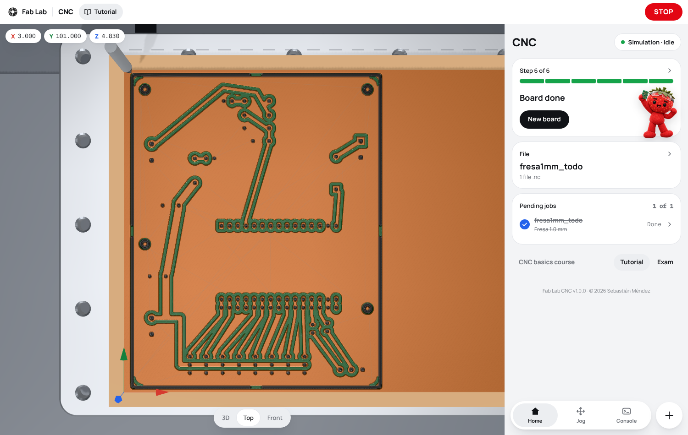

# Tarjeta de servos (una cara): fresado y montaje

- **Tarjeta:** 76 × 96 mm, cobre solo abajo, **sin cables por arriba**.
- **Una sola herramienta:** todo se fresa con la **fresa plana de 1.0 mm**, en un solo archivo.
- **Lleva:** ESP32-B, 8 headers de servo, entrada de 6 V, medición de batería, 5 V de entrada y la borna `PI` (UART4).
- **Arquitectura y cableado:** en `../DOS_TARJETAS.md`.

## Reglas de diseño (verificadas con `tools/verifica_espacios.py`)

- **Hueco de 1.0 mm en todo el cobre**, igual al ancho de la fresa.
- **Pistas:** toda conexión de al menos **1.0 mm**; las filas V+ y GND de los servos, de 1.4 mm, y el 6 V, de 2.5 mm donde cabe.
- **Pads:** redondos de 2.2 mm; ovalados de 1.5 × 2.2 mm en las filas a 2.54 mm.
- **Headers de servo a 5.08 mm**, 20 mm debajo de la ESP32: cada señal baja recta y se abre en diagonal hasta su header.
- **GND en sólido:** los pads de GND van unidos al plano, sin rayos.

## Bornas y headers

| Borna | Orilla | Pines | Va a |
|---|---|---|---|
| J5 | izquierda arriba | +5V, GND | Step-down 5 V |
| J2 | derecha arriba | GND, VBAT | Derivación de batería después del fusible (solo medición, < 10 mA) |
| J6 | derecha abajo | +6V (arriba), GND (abajo) | BEC 6 V, ≥ 10 A |
| J9 `PI` | inferior izquierda | GND, TXD4, RXD4 | HAT de bornas de la Pi: pines 34, 32 y 33 |
| J31–J38 | abajo, a 5.08 mm | SIG (arriba), V+, GND (abajo) | S1–S4 dirección (DI, DD, TI, TD) · S5 brazo base · S6 hombro · S7 pinza · S8 codo/muñeca |

## Fresado en la Cubiko (una herramienta, sin voltear)

**Material:** FR1 de **una cara**, con el cobre arriba. La tarjeta queda en X 3–79 y Y 2–98.

| Archivo | Herramienta | Qué hace | Tiempo |
|---|---|---|---|
| `gcode/fresa1mm_todo.nc` | fresa plana de 1.0 mm | aislamiento (1 pasada a −0.12 mm por red), 93 barrenos de 1.0 mm, barrenos grandes en hélice y contorno con 4 puentes | ~38 min |

El procedimiento es el mismo que en la tarjeta de tracción: homing, cero XY, mapa de alturas y el archivo. La simulación da 0 cortos con un corte real de 0.90 a 1.10 mm.

## Montaje

1. **R15 y R16 (1k) van DE PIE**, entre la ESP32 y J9. El cuerpo va sobre el pad cuadrado.
2. **Piezas bajas:**
   - R22–R26, C5.
   - D6: la banda va hacia la ESP32.
   - LEDs D2 y D4: el pad cuadrado (cátodo) va a GND.
3. **Headers hembra 1x15 de la ESP32** (fila exterior) y **headers macho 1x3** de los servos.
4. **C3 y C4 (1000 µF):** la pata + va al pad marcado.
5. **Bornas.**
6. **Prueba:** sin módulos, mide continuidad SERVO_V–GND y 5V–GND (no deben pitar).

**Simulación:** `sim/reporte.txt` da 0 cortos y 0 redes abiertas.

## Simulación en el Fab Lab (fablab.sebs.mx/cnc)

`fresa1mm_todo.nc` se corrió en el gemelo de la Cubiko (modo *Simulation*): homing, material 142 × 100 × 1.6, cero XY en la esquina, Z0 con la sonda y mapa de alturas 11 × 8. Resultado: **Board done, 1 de 1**, sin errores de GRBL ni salidas del recorrido. La app estima 36 min.

Capturas en `sim/fablab/`, registro en `sim/fablab/registro.txt`.

