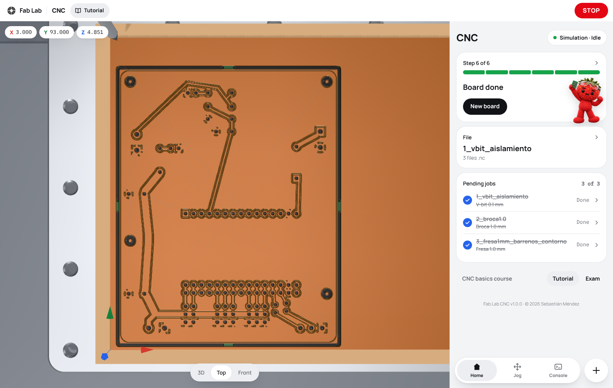

# Tarjeta de servos (una cara): fresado y montaje

- **Tarjeta:** 70 × 88 mm, cobre solo abajo, **sin cables por arriba**.
- **Lleva:** ESP32-B, 8 headers de servo, entrada de 6 V, medición de batería, 5 V de entrada y la borna `PI` (UART4).
- **Arquitectura y cableado:** en `../DOS_TARJETAS.md`.

## Bornas y headers

| Borna | Orilla | Pines | Va a |
|---|---|---|---|
| J5 | izquierda arriba | +5V, GND | Step-down 5 V |
| J2 | derecha arriba | GND, VBAT | Derivación de batería después del fusible (solo medición, < 10 mA) |
| J6 | inferior derecha | GND, +6V | BEC 6 V, ≥ 10 A |
| J9 `PI` | inferior izquierda | GND, TXD4, RXD4 | HAT de bornas de la Pi: pines 34, 32 y 33 |
| J31–J38 | abajo, bajo la ESP32 | SIG (arriba), V+, GND (abajo) | S1–S4 dirección (DI, DD, TI, TD) · S5 brazo base · S6 hombro · S7 pinza · S8 codo/muñeca |

## Fresado en la Cubiko (sin voltear)

**Material:** FR1 de **una cara**, con el cobre arriba. La tarjeta queda en X 3–73 y Y 2–90.

| # | Archivo | Herramienta | Tiempo |
|---|---|---|---|
| 1 | `gcode/1_vbit_aislamiento.nc` | V-bit 20° × 0.1 a −0.10 mm | 18 min |
| 2 | `gcode/2_broca1.0.nc` | broca 1.0 mm (93 agujeros) | 8 min |
| 3 | `gcode/3_fresa1mm_barrenos_contorno.nc` | fresa de 1.0 mm: barrenos grandes y contorno | 17 min |

El procedimiento es el mismo que en la tarjeta de tracción: homing, cero XY, mapa de alturas, y después los archivos 1, 2 y 3.

## Montaje

1. **R15 y R16 (1k) van DE PIE**, entre la ESP32 y J9. El cuerpo va sobre el pad cuadrado y la pata doblada baja junto al otro pad.
2. **Piezas bajas:**
   - R22–R26, C5.
   - D6: la banda va hacia la ESP32.
   - LEDs D2 y D4: el pad cuadrado (cátodo) va a GND.
3. **Headers hembra 1x15 de la ESP32** (fila exterior) y **headers macho 1x3** de los servos.
4. **C3 y C4 (1000 µF):** la pata + va al pad marcado.
5. **Bornas.**
6. **Prueba:** sin módulos, mide continuidad SERVO_V–GND y 5V–GND (no deben pitar).

**Simulación:** `sim/reporte.txt` da 0 cortos y 0 redes abiertas.

## Simulación en el Fab Lab (fablab.sebs.mx/cnc)

Los 3 archivos se corrieron en el gemelo de la Cubiko (modo *Simulation*): homing, material 142 × 100 × 1.6, cero XY en la esquina, Z0 con la sonda y mapa de alturas 11 × 8. Resultado: **Board done, 3 de 3**, sin errores de GRBL ni salidas del recorrido.

| Trabajos (estimación de la app) | `1_vbit` 17 min ✓ · `2_broca` 7 min ✓ · `3_fresa` 16 min ✓ |
|---|---|

Capturas en `sim/fablab/`, registro en `sim/fablab/registro.txt`.

