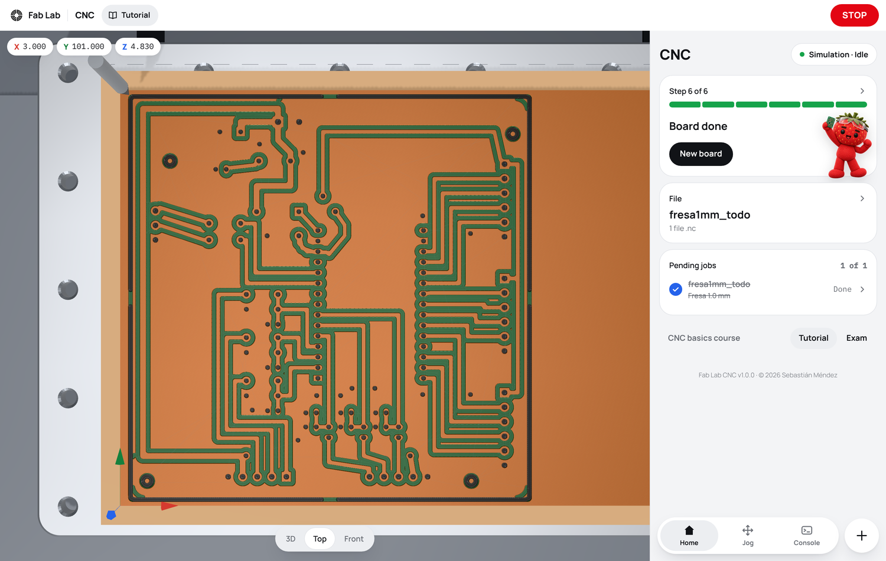
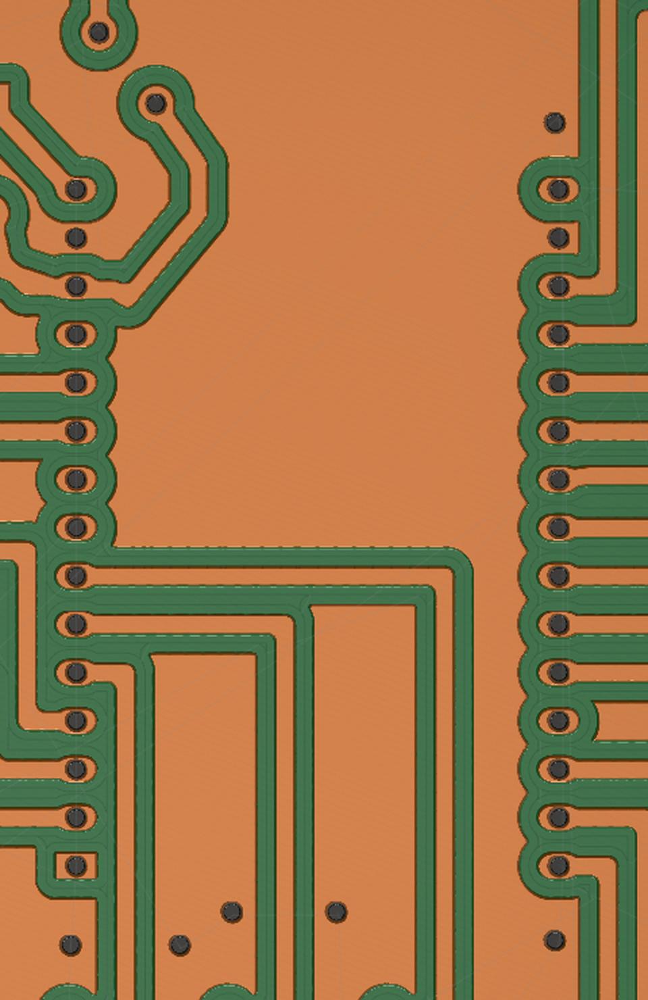
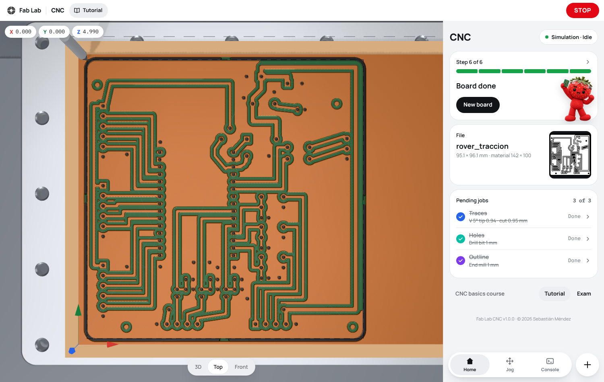

# Tarjeta de tracción (una cara): fresado y montaje

- **Tarjeta:** 95 × 96 mm, cobre solo abajo.
- **Una sola herramienta:** todo (aislamiento, barrenos y contorno) se fresa con la **fresa plana de 1.0 mm**, en un solo archivo. No hay cambios de herramienta.
- **Lleva:** ESP32-A, 3 bornas para los L298N, 2 bornas de encoders con sus 6 divisores, 5 V de entrada y la borna `PI` (UART2).
- **Arquitectura y cableado:** en `../DOS_TARJETAS.md`.

## Reglas de diseño (verificadas con `tools/verifica_espacios.py`)

- **Hueco de 1.0 mm en todo el cobre** (pista–pista, pista–pad, pad–pad, plano–todo). Es justo el ancho de la fresa: cada hueco se fresa con una sola pasada por el centro.
- **Pistas:** toda conexión de al menos **1.0 mm**; +5V y GND de 1.5 mm.
- **Pads:** redondos de **2.2 mm**. En las filas a 2.54 mm (headers de la ESP32) son **ovalados de 1.4 × 2.2 mm**: quedan 1.14 mm libres entre pad y pad, más que la fresa.
- **ESP32 en una sola fila de barrenos por lado** (25.4 mm entre filas, 30 barrenos de 1.0 mm). La huella anterior traía una segunda fila a 1.27 mm (para módulos de 22.86 mm) que encimaba los pads; ya no existe.
- **GND sin rayos:** los pads de GND van unidos al plano en sólido. En la simulación se ven como un barreno dentro del cobre, sin anillo: el plano mismo es el pad, no está incompleto.

## Bornas

| Borna | Orilla | Pines | Va a |
|---|---|---|---|
| J43 · J42 · J41 | izquierda, de arriba a abajo | EN, IN4, IN3, IN2, IN1, GND | L298N #3 (M5/M6) · #2 (M3/M4) · #1 (M1/M2). EN a ENA y ENB con cable en Y |
| J8 | inferior izquierda | GND, +5V, A6, A5, A4 | Encoders de M6, M5 y M4 (cable Pololu: verde GND, azul VCC, amarillo A) |
| J7 | inferior derecha | **A1, A2, A3, +5V, GND** | Encoders de M1, M2 y M3 |
| J5 | superior centro | +5V, GND | Step-down 5 V |
| J9 `PI` | derecha | **GND, RXD2, TXD2** | HAT de bornas de la Pi: pines **6, 29 y 7** |

## Divisores de los encoders

- **M1–M3:** a la derecha de la ESP32, con resistencias acostadas, a 5 mm entre filas y 13 mm entre bloques.
- **M4–M6:** en fila **debajo del módulo**, junto a J8, con las resistencias **de pie**. Así el plano de GND de cada bloque sale entre los pines de J8.

## Fresado en la Cubiko (una herramienta, sin voltear)

**Material:** FR1 de **una cara**, 1.6 mm. Pégalo con cinta doble cara al mártir, con el **cobre arriba**. La tarjeta queda en X 3–98 y Y 2–98 desde la esquina frontal izquierda del blank.

| Archivo | Herramienta | Qué hace | Tiempo |
|---|---|---|---|
| `gcode/fresa1mm_todo.nc` | fresa plana de 1.0 mm | 1. aislamiento: 1 pasada a −0.12 mm alrededor de cada red 2. 96 barrenos de 1.0 mm (bajada directa) 3. barrenos de más de 1.0 mm en hélice 4. contorno con 4 puentes | ~59 min |

1. Monta la fresa de 1.0 mm, haz el homing y pon el **cero XY** en la esquina del blank.
2. Cero Z con la sonda y **mapa de alturas** sobre la tarjeta.
3. Corre `fresa1mm_todo.nc`.
4. Corta los puentes y lija el borde.

- **Aislamiento por red:** cada red lleva su propio canal a 0.5 mm de su cobre. En un hueco de 1.0 mm el canal pasa justo por el centro y lo limpia completo. Donde dos canales caerían uno encima del otro, se fresa una sola vez.
- **Tolerancia:** la simulación da 0 cortos con un corte real de 0.90 a 1.10 mm (fresa gastada o con cabeceo).
- **Velocidades y GRBL:** avance 120 mm/min, bajada 60 mm/min, 10 000 rpm. El resto, como en `../cubiko/README.md`, "Parámetros de fresado".
- **Geometría:** el G-code va espejado (ves la cara de cobre desde arriba). `cobre_espejo_1a1.pdf` muestra cómo queda.

## Montaje

**1. Los 8 cables por arriba** (`mapa_cables_1a1.pdf`, `cables.csv`). Cable aislado de 22 AWG por el lado de los componentes. Cada punta entra por su barreno y se suelda **por abajo**.

| Cable | Red | Largo con holgura | Dónde |
|---|---|---|---|
| W1 | GND | 21 mm | junto a J5 (entrada 5 V) |
| W2 | MOTOR_EN | 15 mm | junto a la ESP32, del lado de R21 (pull-down) |
| W3 | GND | 22 mm | entre J43 y J42 |
| W4 | GND | 22 mm | junto a J41 |
| W5 | GND | 16 mm | arriba de los divisores M6 y M5 |
| W6 | GND | 16 mm | arriba de los divisores M5 y M4 |
| W7 | GND | 24 mm | entre los divisores M1–M3 |
| W8 | +5V | 50 mm | +5V de J7 a J8 (encoders), por la orilla inferior |

Pon los cables **antes** que los headers de la ESP32: W2 pasa junto al módulo.

**2. Las piezas bajas.**
- Resistencias, capacitores de 1 nF y D5 (1N5819, banda del lado de la ESP32).
- Las de M4–M6 van **de pie**: el cuerpo sobre el pad cuadrado y la otra pata doblada hacia abajo.
- LED D3: el pad cuadrado es el cátodo (pata corta) y va a GND.

**3. El resto.** Headers hembra 1x15 de la ESP32 (fila exterior, 25.4 mm), C2 y las bornas.

**4. Prueba.** Sin módulos, mide continuidad 5V–GND: no debe pitar. Luego enciende con la fuente limitada en corriente.

## Simulación

- **`sim/reporte.txt`:** 0 cortos y 0 redes abiertas, contando los 8 cables.
- **`sim/resultado_cobre.png` y `sim/trayectorias.png`:** cómo queda el cobre y por dónde pasan las herramientas.

## Simulación en el Fab Lab (fablab.sebs.mx/cnc)

Las 2 formas se corrieron en el gemelo de la Cubiko (modo *Simulation*): homing, material 142 × 100 × 1.6, cero XY en la esquina, Z0 con la sonda y mapa de alturas 11 × 8.

**1. Nuestro G-code (`gcode/fresa1mm_todo.nc`): la forma recomendada.** Resultado: **Board done, 1 de 1**, con la fresa de 1.0 mm todo el tiempo, sin errores de GRBL. La app estima 57 min. Ya va espejado (cobre abajo).

Acercamiento a los pines de la ESP32: una sola fila de barrenos por lado y cada pad separado por el canal de 1 mm.

**2. El generador de la app (Gerbers → *Traces* con 1 pasada).** La app desplaza todo el cobre junto el radio de la fresa. En un hueco de exactamente 1.0 mm, con la fresa declarada de 1.0 mm no encuentra camino y deja unidas las redes. Declarando la fresa un poco más angosta sí pasa por el centro de cada hueco, y la fresa real de 1.0 mm lo limpia completo:

| Fresa declarada en *Traces* (1 pasada) | Cortos (corte real de 1.0 mm) |
|---|---|
| 0.90 mm | 0 |
| **0.95 mm** (punta 0.94, ángulo 5°, profundidad 0.12) | **0** |
| 1.00 mm | 2 |
| 1.01 mm | 3 |

Con 0.95 mm: **Board done, 3 de 3** (*Traces*, *Holes* con 1.0 mm y *Outline* con 1.0 mm), 0 cortos y ningún pad dañado. La app pide permitir valores fuera de rango, porque *Traces* espera una fresa en V. Ojo: la app **no espeja** el cobre inferior; para fresar de verdad usa `fresa1mm_todo.nc`.

Registros: `sim/fablab/registro.txt` y `sim/fablab/registro_app_1pasada.txt`.
