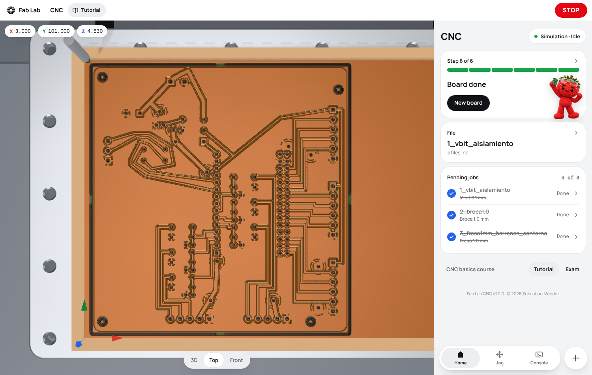

# Tarjeta de tracción (una cara): fresado y montaje

- **Tarjeta:** 92 × 96 mm, cobre solo abajo.
- **Lleva:** ESP32-A, 3 bornas para los L298N, 2 bornas de encoders con sus divisores, 5 V de entrada y la borna `PI` (UART2).
- **Arquitectura y cableado:** en `../DOS_TARJETAS.md`.

## Bornas

| Borna | Orilla | Pines | Va a |
|---|---|---|---|
| J43 · J42 · J41 | izquierda, de arriba a abajo | EN, IN4, IN3, IN2, IN1, GND | L298N #3 (M5/M6) · #2 (M3/M4) · #1 (M1/M2). EN a ENA y ENB con cable en Y |
| J8 | inferior izquierda | GND, +5V, A6, A5, A4 | Encoders de M6, M5 y M4 (cable Pololu: verde GND, azul VCC, amarillo A) |
| J7 | inferior centro | GND, +5V, A1, A2, A3 | Encoders de M1, M2 y M3 |
| J5 | superior derecha | +5V, GND | Step-down 5 V |
| J9 `PI` | derecha | GND, TXD2, RXD2 | HAT de bornas de la Pi: pines 6, 7 y 29 |

## Fresado en la Cubiko (sin voltear)

**Material:** FR1 de **una cara**, 1.6 mm. Pégalo con cinta doble cara al mártir, con el **cobre arriba**. La tarjeta queda en X 3–95 y Y 2–98 desde la esquina frontal izquierda del blank.

| # | Archivo | Herramienta | Tiempo |
|---|---|---|---|
| 1 | `gcode/1_vbit_aislamiento.nc` | V-bit 20° × 0.1 a −0.10 mm, 120 mm/min | 40 min |
| 2 | `gcode/2_broca1.0.nc` | broca 1.0 mm (105 agujeros) | 9 min |
| 3 | `gcode/3_fresa1mm_barrenos_contorno.nc` | fresa de 1.0 mm: barrenos de 1.2 mm o más, contorno con 4 puentes | 24 min |

1. Haz el homing y pon el **cero XY** en la esquina del blank.
2. Cero Z con la sonda y **mapa de alturas** sobre la tarjeta. Sin mapa, el corte de 0.10 mm no sale parejo.
3. Corre los archivos 1, 2 y 3. Antes de cada uno: cambia la herramienta y haz el cero Z.
4. Corta los puentes y lija el borde.

- **Velocidades, profundidades y GRBL:** son los mismos valores del Fab Lab, en `../cubiko/README.md`, "Parámetros de fresado".
- **Geometría:** el G-code ya va espejado (ves la cara de cobre desde arriba). `cobre_espejo_1a1.pdf` muestra cómo queda.

## Montaje

**1. Los 5 cables por arriba** (`mapa_cables_1a1.pdf`, `cables.csv`). Cada cable es un tramo de cable aislado de 22 AWG que va por el lado de los componentes. Sus 2 puntas entran por los barrenos marcados con diana y se sueldan **por abajo**, como la pata de un componente.

| Cable | Red | Largo con holgura |
|---|---|---|
| W1 | GND | 18 mm |
| W2 | GND | 25 mm |
| W3 | +5V | 18 mm |
| W4 | +5V | 43 mm |
| W5 | +5V | 32 mm |

Pon los cables **antes** que los headers de la ESP32: W1 y W4 pasan junto al módulo y después ya no se alcanzan bien.

**2. Las piezas bajas.** Resistencias, capacitores de 1 nF y diodos.
- D5 (1N5819): la banda va del lado de la ESP32.
- LED D3: el pad cuadrado es el cátodo (pata corta) y va a GND.

**3. El resto.** Headers hembra 1x15 de la ESP32 (fila exterior), C2, bornas.

**4. Prueba.** Sin módulos, mide continuidad 5V–GND: no debe pitar. Luego enciende con la fuente limitada en corriente.

## Simulación

- **`sim/reporte.txt`:** 0 cortos y 0 redes abiertas, contando los 5 cables.
- **`sim/resultado_cobre.png` y `sim/trayectorias.png`:** cómo queda el cobre y por dónde pasan las herramientas.
- **`sim/fablab/`:** la corrida en el simulador del Fab Lab.

## Simulación en el Fab Lab (fablab.sebs.mx/cnc)

Los 3 archivos se corrieron en el gemelo de la Cubiko (modo *Simulation*): homing, material 142 × 100 × 1.6, cero XY en la esquina, Z0 con la sonda y mapa de alturas 11 × 8. Resultado: **Board done, 3 de 3**, sin errores de GRBL ni salidas del recorrido.

| Trabajos (estimación de la app) | `1_vbit` 40 min ✓ · `2_broca` 7 min ✓ · `3_fresa` 24 min ✓ |
|---|---|

Capturas en `sim/fablab/`, registro en `sim/fablab/registro.txt`.

