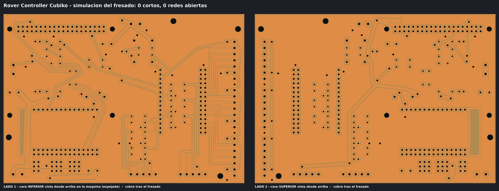

# Rover Controller Cubiko: tarjeta para fresar en la Genmitsu Cubiko

Variante de la v1.2 adaptada al área de trabajo de la **Genmitsu Cubiko** (≈145–150 × 110 × 40 mm, husillo 775 de 75 W a 10 000 RPM máx., GRBL 1.1h).

- La tarjeta mide **136 × 96 mm**, en 2 caras, sin barrenos metalizados.
- Lleva la **Raspberry Pi 5** (debajo de la tarjeta), las **2 ESP32** y los **8 servos**.
- Los **3 L298N van en el chasis**, con sus bornas originales. Se conectan a la tarjeta con **bornas de tornillo en las orillas**.


| Verificación | Resultado |
|---|---|
| DRC de KiCad | 0 violaciones, 0 conexiones pendientes |
| Conectividad **sin metalizado**: cada pad conecta solo por su cara de soldadura | 0 conexiones abiertas (41 vías-pin) |
| **Simulación del fresado** (`tools/cubiko_cam.py`): resta del cobre el ancho real del V-bit y los taladros | **0 cortos, 0 redes abiertas** |
| Firmware simulado sobre el netlist, con el cableado externo a los L298N y a los encoders | 87/87 OK (48 tracción + 39 servos) |
| G-code dentro del recorrido de la máquina | X 2–140 mm, Y 1–101 mm, Z −4.6 a 5 mm |



## Qué cambia respecto a la v1.2

| v1.2 (200 × 150) | Cubiko (136 × 96) |
|---|---|
| L298N soldados sobre la tarjeta | **L298N en el chasis**, conservando sus bornas azules; se cablean a 3 bornas de 7 vías |
| Batería por XT60 en la tarjeta | La batería **no entra a la tarjeta**: un arnés reparte batería → fusible → L298N, step-down 5 V y BEC 6 V. J2 solo mide la batería (< 10 mA). |
| Encoders alimentados por el 78M05 de cada L298N | Encoders alimentados por el **+5V de la tarjeta**, con 2 bornas de 5 vías |
| ESP32-B por UART0 de la Pi (GPIO14/15) | ESP32-B por **UART4 de la Pi (GPIO12/13, pines 32/33, `/dev/ttyAMA4`)**: el header queda pegado a la orilla y los pines exteriores no tienen salida |
| Firmware de las ESP32 | **Sin cambios**: misma asignación de pines |

Las ESP32 no usan WiFi; las dos hablan con la Pi por UART. Por eso, bajo la ESP32-A van los divisores de los encoders 4–6, que son resistencias acostadas y capacitores de disco. La ESP32-B conserva su zona libre de cobre bajo la antena.

## Conexiones

| Borna | Orilla | Pines (en orden) | Va a |
|---|---|---|---|
| J43 · L298N #3 (M5/M6) | izquierda, arriba | ENB, IN4, IN3, IN2, IN1, ENA, GND | Header lógico del L298N #3 (**quita los jumpers ENA/ENB**) y su borna GND |
| J42 · L298N #2 (M3/M4) | izquierda, centro | igual | L298N #2 |
| J41 · L298N #1 (M1/M2) | izquierda, abajo | igual | L298N #1 |
| J8 · ENC M6 M5 M4 | inferior izquierda | GND, +5V, A6, A5, A4 | Cables de encoder: verde = GND, azul = VCC, amarillo = A (el blanco/B no se usa) |
| J7 · ENC M1 M2 M3 | inferior centro | GND, +5V, A1, A2, A3 | igual |
| J6 · SERVO 6V | inferior derecha | −, + | Salida del BEC de 6 V |
| J5 · 5V IN | superior | +, − | Salida del step-down de 5 V / 5 A |
| J2 · BAT 12V | derecha | −, + | Batería **después del fusible** (solo medición) |
| J31–J38 · S1…S8 | abajo de la ESP32-B | SIG (arriba), V+, GND (abajo) | Servos |

```
Batería 3S ─► fusible 15 A ─┬─► L298N #1, #2, #3 (+12V y GND, cable ≥ 18 AWG)
                            ├─► step-down 5V/5A ─► J5 (Pi 5, ESP32, encoders)
                            ├─► BEC 6V ≥10A ────► J6 (servos)
                            └─► J2 (medición de batería)
GND común: une las GND de los L298N, el step-down y el BEC en el negativo de la batería (estrella).
```

En el L298N deja puesto el jumper **5V-EN**, que alimenta su lógica, y quita los jumpers ENA/ENB.

**En la Raspberry Pi**, en `/boot/firmware/config.txt`:

```
dtoverlay=uart2-pi5
dtoverlay=uart4-pi5
usb_max_current_enable=1
```

Antes de correr el enlace con las ESP32:

```bash
export ROVER_ESPB_PORT=/dev/ttyAMA4
```

## Material y herramientas

| Qué | Especificación |
|---|---|
| Placa virgen | FR1 (fenólica) **doble cara**, 1.6 mm, cobre 35 µm. Recorta una de 150 × 100 a **142 × 100 mm**. Evita FR4: su polvo de fibra de vidrio es peligroso. |
| Martir | MDF o madera plana de ≥ 6 mm, atornillada a la cama |
| Sujeción | Cinta doble cara delgada en toda la placa: los clamps estorban en un blank de 100 mm |
| T1 V-bit | 30°, punta 0.1 mm, zanco 3.175 mm (aislamiento de las 2 caras) |
| T2 / T3 / T4 brocas | 0.8 mm, 1.0 mm y 1.2 mm, de carburo para PCB, zanco 3.175 |
| T5 fresa plana | 2.0 mm, 2 filos: pines de alineación, barrenos grandes, zona de antena y contorno |
| Pines de alineación | 2 pines de acero de **Ø3 mm** (sirven los zancos de brocas de 3 mm rotas) |
| Sonda | Placa de sonda de la Cubiko, con el caimán en el cobre |
| Software | **Candle** o **bCNC** para el mapa de alturas (autonivelado). Puedes usar **gSender** si tu versión ya tiene mapa de alturas. |

## Parámetros de fresado

Ya están dentro de los archivos `gcode/*.nc`. Si quieres regenerarlos con otros valores, cambia el diccionario `P` en `tools/cubiko_cam.py`.

| Operación | Herramienta | RPM | Avance | Bajada | Profundidad | Notas |
|---|---|---|---|---|---|---|
| Aislamiento B y F | V-bit 30° × 0.1 | 10 000 | **150 mm/min** | 60 mm/min | **−0.08 mm** | 2 pasadas, traslape 30 %. Ancho de corte 0.143 mm. Altura segura 1.0 mm. |
| Taladros | brocas 0.8 / 1.0 / 1.2 | 10 000 | — | 60 mm/min | −1.9 mm | Atraviesa 1.6 mm y entra 0.3 mm en la cinta / martir |
| Pines de alineación | fresa 2.0 | 10 000 | 90 mm/min (helicoidal) | 30 mm/min | −4.6 mm | 1.6 de placa + 3 mm en el martir. Ø3.0 mm. |
| Barrenos M3 y M2.5 | fresa 2.0 | 10 000 | 90 mm/min | 30 mm/min | −1.9 mm | Helicoidal, pasos de 0.3 mm |
| Despeje bajo la antena de la ESP32-B | fresa 2.0 | 10 000 | 150 mm/min | 30 mm/min | −0.12 mm | Solo el cobre que no es de ninguna red |
| Contorno | fresa 2.0 | 10 000 | 150 mm/min | 30 mm/min | −1.8 mm | Pasos de 0.3 mm, por fuera de la línea. 4 pestañas de 3 mm que dejan 0.6 mm. |

**Revisa en GRBL** (envía `$$`) antes del primer trabajo:
- **`$30`** debe ser la RPM máxima del husillo (10 000). Si es 1000, cambia `rpm` en `cubiko_cam.py` o pon `$30=10000`.
- **`$32=0`**: modo láser apagado.
- **`$110`, `$111` y `$112`** deben ser ≥ 1500 mm/min: los viajes en vacío usan G0.

**Por qué estos valores:**
- **Ancho del corte.** El V-bit corta más ancho entre más baja: 0.1 + 2·d·tan 15° → a 0.08 mm da 0.143 mm. La separación mínima del diseño es 0.5 mm, así que hay margen de sobra.
- **Profundidad.** El cobre mide 35 µm. 0.08 mm lo atraviesa aunque la placa tenga una pequeña ondulación, siempre que se use el **mapa de alturas**.
- **Velocidades.** Con 75 W y 10 000 RPM, 150 mm/min deja una carga por filo de ~0.015 mm: corte limpio sin romper la punta.

### Si prefieres FlatCAM

Usa los Gerbers de `gerbers/`. Los equivalentes son:

| Operación | Valores |
|---|---|
| Isolation | V-shape, punta 0.1 mm, ángulo 30°, Cut Z −0.08 mm, Passes 2, Overlap 30 %, Feedrate X-Y 150 mm/min, Feedrate Z 60 mm/min, Travel Z 1.0 mm, Spindle 10 000 |
| Lado 1 | Abre `B_Cu`, el `.drl` y `Edge_Cuts`. Espéjalos con el **Double-Sided Tool**: Mirror Axis **Y**, referencia **Box** = `Edge_Cuts` (eje vertical al centro de la tarjeta, igual que los pines de alineación). El lado 2 (`F_Cu`) no se espeja. |
| Drilling | Cut Z −1.9 mm, Feedrate Z 60 mm/min, Travel Z 1.0 mm |
| Cutout | Tool 2.0 mm, Cut Z −1.8 mm, Multi-depth 0.3 mm, Gaps 4, Gap size 3 mm |

## Paso a paso

Hay 7 archivos, en este orden. El tiempo estimado es **~4 h** de máquina, más cambios de herramienta y mapas de alturas.

| # | Archivo | Herramienta | Tiempo |
|---|---|---|---|
| 1 | `L1_1_fresa2mm_alineacion_barrenos_antena_B.nc` | fresa 2.0 | 11 min |
| 2 | `L1_2_vbit_aislamiento_B.nc` | V-bit | 104 min |
| 3 | `L1_3_broca0.8.nc` | broca 0.8 (64 agujeros) | 5 min |
| 4 | `L1_4_broca1.0.nc` | broca 1.0 (205 agujeros) | 15 min |
| 5 | `L1_5_broca1.2.nc` | broca 1.2 (39 agujeros) | 3 min |
| — | **voltear la placa** | | |
| 6 | `L2_1_vbit_aislamiento_F.nc` | V-bit | 84 min |
| 7 | `L2_2_fresa2mm_antena_contorno_F.nc` | fresa 2.0 | 21 min |

### Lado 1: cara inferior hacia arriba

1. Pega el blank de 142 × 100 sobre el martir con cinta doble cara en toda la superficie. El lado largo va en X. Déjalo cerca del origen de la máquina, para que X llegue a 141 mm.
2. **Cero XY** en la esquina frontal izquierda del blank. **Anota las coordenadas de máquina (MPos)** de ese cero: no lo vuelvas a mover en todo el proceso, ni al voltear.
3. Monta la fresa de 2.0 y haz el **cero Z con la sonda** sobre el cobre. Corre el **archivo 1**: pines de alineación, barrenos grandes y despeje de antena.
4. Cambia al V-bit y haz el cero Z con la sonda. Haz el **mapa de alturas** sobre 136 × 96 mm: malla de 10 × 8 puntos (~14 mm), con el origen en X3 Y2. Corre el **archivo 2** aplicando el mapa.
5. Corre los **archivos 3, 4 y 5**. Haz el cero Z en cada cambio de broca; el taladrado no necesita mapa de alturas.
6. Aspira el polvo.

### Voltear

7. Despega la placa **sin mover la cama**. En el martir quedaron dos barrenos de Ø3 hechos en el paso 3. **Mete los 2 pines de Ø3 en el martir.**
8. Voltea la placa **de izquierda a derecha**, sobre el eje vertical, y ensártala en los pines. El barreno de H1 queda en el pin que antes ocupaba el barreno de la Pi, y al revés. Pégala con cinta nueva y **saca los pines** antes de cortar.

### Lado 2: cara superior hacia arriba

9. Haz el cero Z con la sonda y un **mapa de alturas nuevo**, porque la placa cambió de posición. **No toques el cero XY.**
10. Corre el **archivo 6** (V-bit, cara superior) con el mapa aplicado.
11. Cambia a la fresa de 2.0, haz el cero Z y corre el **archivo 7**: despeje de antena y contorno con 4 pestañas.
12. Corta las pestañas con cúter o segueta y lija el borde.

**Antes de la placa real**, haz una prueba en un retazo: un cuadro de 20 × 20 mm con el aislamiento.
- **El canal debe medir ~0.15 mm de ancho** y verse sin cobre al fondo.
- **Si quedan puentes de cobre:** baja 0.02 mm la profundidad (`iso_depth`).
- **Si el canal sale de más de 0.25 mm:** súbela.

## Montaje

1. **Vías-pin (41):** mete un pin de header o un alambre de 0.8–0.9 mm en cada vía y **suéldalo por las dos caras**. Córtalo a ras. Varias quedan bajo la ESP32-A: suéldalas antes que los zócalos.
2. **Bajo la ESP32-A** van los divisores de los encoders 4–6. Suéldalos (resistencias acostadas y capacitores de disco) **antes** que los headers hembra de la ESP32-A.
3. El resto de los componentes, de menor a mayor altura. Todos se sueldan **por abajo**, menos el **header 2x20 de la Pi**: va abajo y se suelda **por arriba**.
4. Las ESP32 van en headers hembra **1x15 en la fila exterior** (25.4 mm entre filas). La fila doble de pads también acepta clones de 22.86 mm.
5. **Pruebas sin módulos:** continuidad 5V–GND y SERVO_V–GND (no debe pitar). Luego enciende con fuente limitada en corriente.

## Notas y límites

- **H1** se taladra a Ø3.0 porque es pin de alineación. Para atornillar usa M2.5, o agrándalo a 3.2 con broca después de terminar.
- **Rail de servos con cobre de 35 µm:** las pistas V+/GND de los servos y de J6 miden 1.6–2.5 mm. Para más de 5 A continuos, **estáñalas** o suelda encima un alambre desnudo de 1 mm².
- **Plano de GND superior:** el cobre que no se fresa arriba queda unido a GND por las vías. No queda flotando.
- **Dónde se configura:** la tarjeta se genera desde `tools/rover_cubiko.py`, y el CAM y la simulación desde `tools/cubiko_cam.py`. Los comandos están abajo.

```bash
cd hardware/tools
```

```bash
ROVER_VARIANT=cubiko python3 generate.py --route
```

```bash
ROVER_VARIANT=cubiko python3 cubiko_cam.py
```
