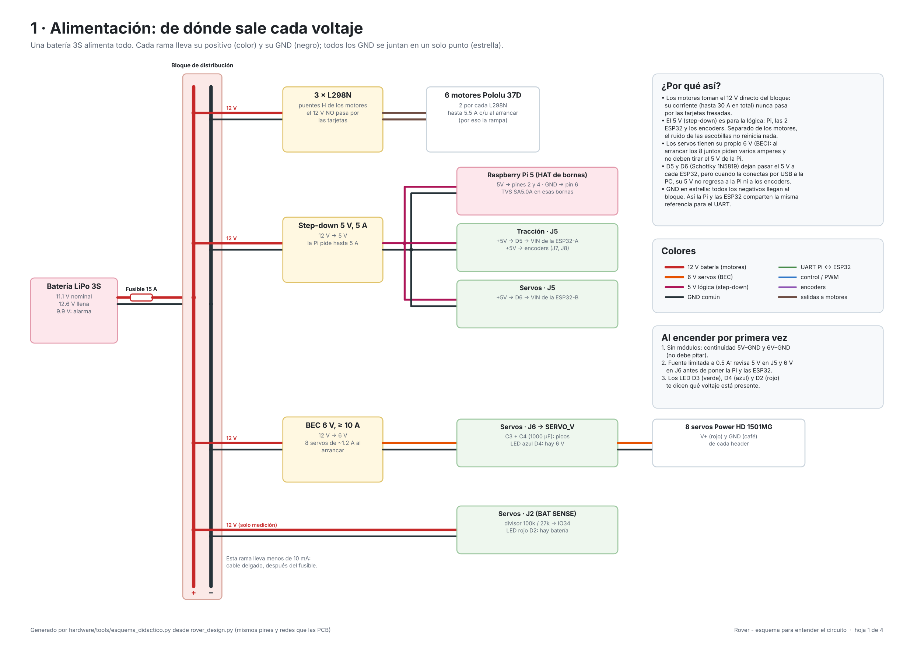
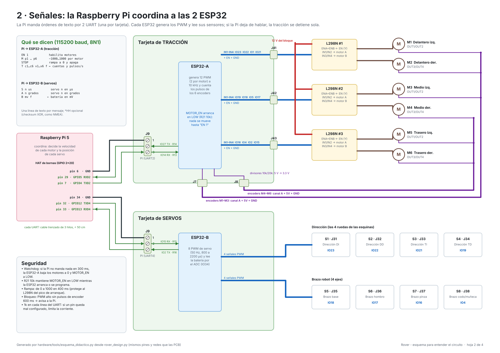
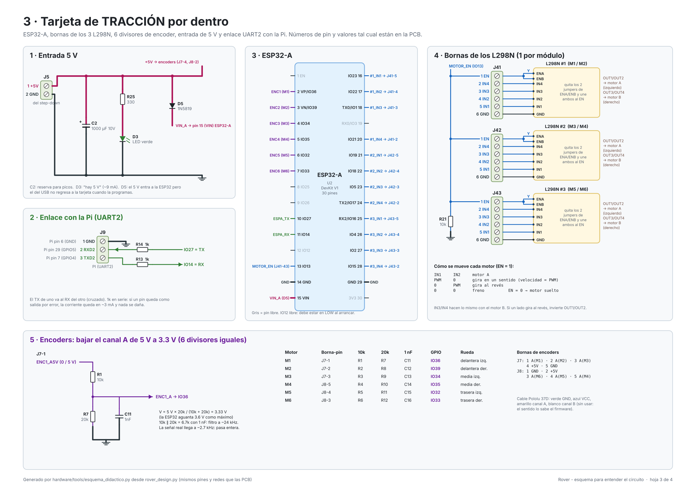
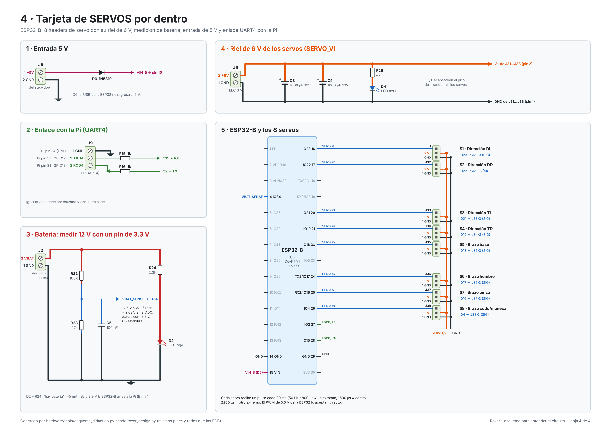

# Esquema para entender el circuito

`esquema_rover.pdf`: 4 hojas A3 hechas para **entender** el rover, no para fabricarlo. Para fabricar están los esquemáticos de KiCad (`cnc_*/esquematico_*.pdf`).

| Hoja | Qué explica |
|---|---|
| 1 · Alimentación | De dónde sale cada voltaje: batería 3S, fusible, bloque de distribución, step-down 5 V, BEC 6 V y la derivación para medir la batería. |
| 2 · Señales | Cómo la Raspberry Pi coordina a las 2 ESP32: los 2 UART, las bornas de los L298N, los motores, los encoders, los 8 servos, el protocolo de texto y la seguridad (watchdog, pull-down de MOTOR_EN, rampa). |
| 3 · Tracción por dentro | Entrada 5 V, UART2 con sus 1k, los 30 pines de la ESP32-A, las bornas de los L298N con el cable en Y, la tabla de verdad del motor y los 6 divisores de encoder. |
| 4 · Servos por dentro | Entrada 5 V, UART4, el divisor de batería con su cálculo, el riel de 6 V y los 8 headers de servo con su GPIO. |

**Colores:** rojo 12 V · naranja 6 V · magenta 5 V · negro GND · verde UART · azul control/PWM · morado encoders · café salidas a motores.

Los pines, redes y valores se leen de `tools/rover_design.py`, igual que las PCB. Para regenerar:

```bash
cd hardware/tools
python3 esquema_didactico.py
```





